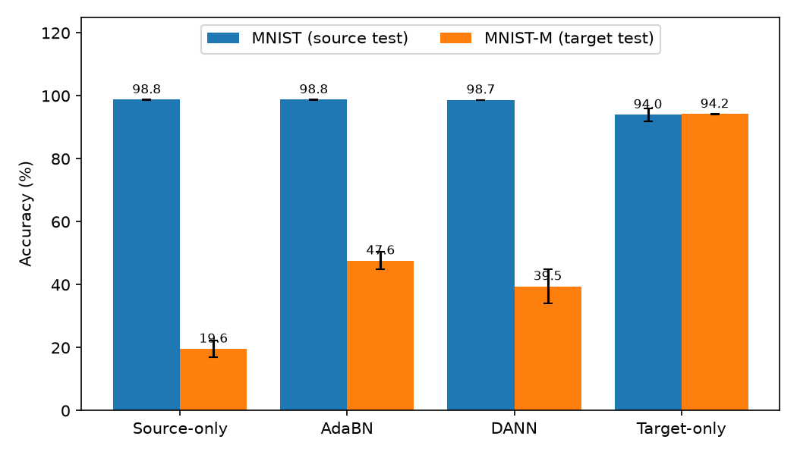
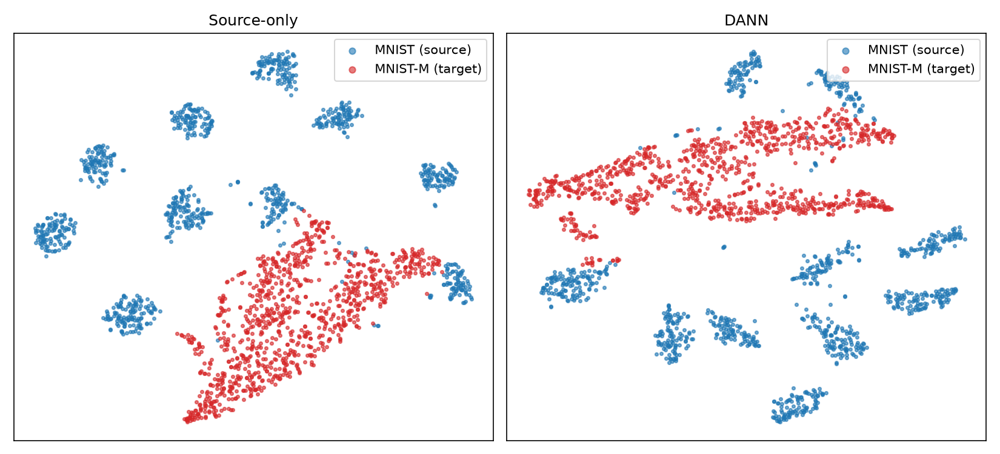

# Domain Shift in Neural Networks: AdaBN vs DANN on MNIST to MNIST-M

This repository holds a survey report on domain shift and domain adaptation in artificial neural networks, and a small reproducible experiment that goes with it. The experiment trains one small CNN on MNIST and tests it on MNIST-M, then compares four ways of handling the shift: source-only training, a target-only upper bound, AdaBN, and DANN. Everything in the report's results chapter is read from `results/results.json`, which the notebook writes.

## Motivation

Zech et al. (2018) trained convolutional neural networks to detect pneumonia in chest radiographs and tested them at hospitals outside the training set. In 3 of 5 comparisons the models did worse at the outside hospital than at the hospital they were trained on. The same models could also tell which hospital system an X-ray came from, with 99.95% accuracy for NIH and 99.98% for Mount Sinai, so they had access to cues that have nothing to do with pneumonia.

This is domain shift: the data a model sees in use is drawn from a different distribution than its training data (a different scanner, hospital, camera, or season), while the task stays the same. Accuracy measured on held-out data from the training distribution then says little about accuracy in deployment. Domain adaptation is the set of methods that try to close that gap, for example by aligning features across domains or by re-estimating normalization statistics on the new data.

## What this repository contains

- A survey report (`report/Domain_Shift_Survey_Report.docx`, about 45 pages) covering the types of domain shift, the theory behind it, and the main families of adaptation methods, with a sprint-style account of the experiment.
- A notebook (`notebooks/domain_shift.ipynb`) and a helper module (`src/da.py`) that run the experiment end to end on CPU.
- The saved results (`results/results.json`) and all figures (`figures/`).
- The scripts that build the Word report from `results.json` (`report/`).
- A smoke test and a CI workflow (`tests/`, `.github/workflows/smoke.yml`).

## Setup

- Source domain: MNIST handwritten digits, resized to 32x32 and copied to 3 channels.
- Target domain: MNIST-M, loaded from the Hugging Face dataset [`Mike0307/MNIST-M`](https://huggingface.co/datasets/Mike0307/MNIST-M) (59,001 train and 9,001 test images, 32x32 RGB). MNIST-M blends MNIST digits with random color patches from photographs.
- Both domains are scaled to [-1, 1] with the same mean and std (0.5, 0.5). The notebook prints an audit of tensor types, ranges and channel statistics before training.
- Training uses a random 10,000-image subsample of each domain. Testing uses the full MNIST test set (10,000 images) and the full MNIST-M test set (9,001 images).
- Backbone for every method: three Conv-BatchNorm-ReLU-MaxPool blocks (32, 64, 128 channels), a 2048 to 128 linear layer, then a 128 to 10 classifier.
- Training recipe for every method: SGD with momentum 0.9, learning rate `0.01 / (1 + 10p)^0.75` where `p` is training progress from 0 to 1 (the schedule from Ganin and Lempitsky), batch size 128, 30 epochs.
- Seeds: 0, 1, 2. Results are reported as mean ± std over the three seeds, and every individual seed is listed below.

## Methods

**Source-only.** The backbone is trained on labeled MNIST only and evaluated on both test sets. This is the lower reference: what happens if the shift is ignored.

**Target-only.** The same backbone is trained on labeled MNIST-M. This is an upper bound that uses target labels, which unsupervised adaptation does not have.

**AdaBN** (Li et al., 2016). Take the source-only model and replace the batch normalization running mean and variance with statistics computed on unlabeled target images. No weights are trained. Because it keeps two sets of statistics, MNIST is scored with the source statistics and MNIST-M with the target statistics, so MNIST accuracy is identical to source-only by construction.

**DANN** (Ganin and Lempitsky, 2015; Ganin et al., 2016). A domain classifier is attached to the 128-dimensional features and trained to tell source images from target images, while the feature extractor is trained to make that impossible. This is done with a gradient reversal layer: it is the identity in the forward pass and multiplies the gradient by `-lambda` in the backward pass. The domain classifier therefore learns to separate the domains, while the layers below it receive the opposite gradient and learn features that confuse it. Labels are used on the source only, and `lambda` grows from 0 to 1 during training as `2 / (1 + exp(-10p)) - 1`. In this implementation each step passes a concatenated source and target batch through the backbone, so BatchNorm statistics in DANN are computed over both domains.

The "gap closed" column is `(method - source-only) / (target-only - source-only)` on MNIST-M, computed per seed and then averaged.

## Results

Mean ± std over seeds 0, 1, 2 (30 epochs each):

| Method | MNIST acc (%) | MNIST-M acc (%) | Gap closed (%) |
|---|---|---|---|
| Source-only | 98.75 ± 0.07 | 19.62 ± 2.56 | n/a |
| AdaBN | 98.75 ± 0.07 | 47.63 ± 2.77 | 37.6 ± 1.6 |
| DANN | 98.69 ± 0.05 | 39.47 ± 5.47 | 26.7 ± 5.7 |
| Target-only | 94.01 ± 2.02 | 94.18 ± 0.10 | 100 (by definition) |

Every seed:

| Method | MNIST-M acc, seed 0 / 1 / 2 | MNIST acc, seed 0 / 1 / 2 | Gap closed, seed 0 / 1 / 2 |
|---|---|---|---|
| Source-only | 20.28 / 22.39 / 16.21 | 98.83 / 98.75 / 98.67 | n/a |
| AdaBN | 48.29 / 50.64 / 43.96 | 98.83 / 98.75 / 98.67 | 37.9 / 39.4 / 35.5 |
| DANN | 45.71 / 40.31 / 32.40 | 98.76 / 98.66 / 98.65 | 34.4 / 25.0 / 20.7 |
| Target-only | 94.17 / 94.06 / 94.31 | 95.39 / 95.48 / 91.15 | n/a |





Findings:

- A model that is near-perfect on MNIST (98.75%) scores 19.62% on MNIST-M. The shift is large for this network.
- AdaBN closed more of the gap than DANN in every seed (37.9 vs 34.4, 39.4 vs 25.0, 35.5 vs 20.7), with no training and about one second of compute.
- DANN improved on source-only in every seed, but it closed 26.7% of the gap on average and varies more across seeds than AdaBN does. It is a modest improvement here, not a large one.
- DANN's domain loss reached ln 2 (about 0.693) by the end of training, the value expected when the domain classifier cannot beat chance. The t-SNE plot still shows source and target features in separate regions, so a domain loss at chance did not by itself mean the domains were aligned.
- These numbers are not directly comparable to Ganin and Lempitsky (2015), who report 57.5% source-only and 81.5% DANN accuracy on MNIST to MNIST-M. They used a different network, a different amount of training data, and their own copy of MNIST-M. The ordering (DANN above source-only) agrees; the absolute values do not.
- Before the final run, the preprocessing of both domains was audited and no problem was found, and the AdaBN evaluation was changed to use source statistics for MNIST (previously it used target statistics for both domains, which lowered its MNIST score). An earlier run with the Adam optimizer is not reported.

## Reproducing

Tested with Python 3.13 on Windows, CPU only.

```bash
python -m venv .venv
source .venv/bin/activate        # Windows: .venv\Scripts\activate
pip install -r requirements.txt --extra-index-url https://download.pytorch.org/whl/cpu
```

Run the experiment (downloads MNIST and MNIST-M on first use, about 25 minutes on a laptop CPU for 3 seeds; per seed, training takes about 100 s for source-only, 200 s for DANN and 110 s for target-only, and AdaBN takes about 1 s):

```bash
jupyter nbconvert --to notebook --execute --inplace notebooks/domain_shift.ipynb
```

or open `notebooks/domain_shift.ipynb` in Jupyter and run all cells. The notebook writes `results/results.json` and regenerates the figures in `figures/`. Seeds are fixed (0, 1, 2), so accuracies should reproduce on the same software versions; the `train_seconds_per_run` timings in `results.json` will differ from machine to machine.

Rebuild the Word report from `results/results.json`:

```bash
python report/make_report.py
```

On Windows with Microsoft Word installed, `report/update_toc.ps1` then refreshes the table of contents page numbers. The taxonomy and architecture diagrams are drawn by `report/make_diagrams.py`.

Run the smoke test (synthetic data, one epoch per method, under a minute on CPU, no download):

```bash
python -m pytest tests -q
```

## Repository structure

```
.
├── README.md
├── LICENSE
├── CITATION.cff
├── requirements.txt
├── notebooks/
│   └── domain_shift.ipynb        experiment, runs end to end
├── src/
│   └── da.py                     data loading, backbone, AdaBN, DANN, plots
├── results/
│   └── results.json              every number used in the report
├── figures/                      generated figures (samples, bar chart, t-SNE, logs, diagrams)
├── report/
│   ├── Domain_Shift_Survey_Report.docx
│   ├── make_report.py            builds the report from results.json
│   ├── build_report.py           front matter, chapters 1-2
│   ├── report_sprints.py         chapters 3-6
│   ├── report_end.py             chapters 7-10, references, appendix
│   ├── docx_helpers.py           python-docx helpers
│   ├── make_diagrams.py          taxonomy and architecture figures
│   ├── update_toc.ps1            refreshes TOC page numbers (Windows, Word)
│   └── assets/srm_logo.jpeg
├── tests/
│   └── test_smoke.py
└── .github/workflows/smoke.yml
```

## Data

MNIST and MNIST-M are used under their own licenses. They are downloaded at runtime and are not redistributed in this repository. The code is released under the MIT License (see `LICENSE`).

## Limitations

- This is a toy benchmark. MNIST to MNIST-M is a synthetic shift, and the conclusions may not carry over to real shifts such as the hospital setting that motivates the work.
- The backbone is a small CNN trained on 10,000 images per domain for 30 epochs. Larger networks, more data or other hyperparameters could change the ranking of the methods.
- Three seeds give a rough estimate of variance only. DANN's spread across seeds is large (gap closed 20.7 to 34.4).
- DANN was run once with the Ganin recipe and no per-method tuning. Why it closed less of the gap than AdaBN here is not established. Candidate explanations, such as the BatchNorm statistics being mixed across domains in the concatenated batch or the small training set, were not tested separately.
- The low source-only accuracy on MNIST-M (19.62%) is lower than the 57.5% reported by Ganin and Lempitsky. The difference was not isolated, since the network, data size and MNIST-M copy all differ.
- Only AdaBN and DANN are implemented. The other methods in the report (DAN, Deep CORAL, ADDA, CyCADA, TENT and others) are described, not run.

## References

- Zech, J. R., Badgeley, M. A., Liu, M., Costa, A. B., Titano, J. J., & Oermann, E. K. (2018). Variable generalization performance of a deep learning model to detect pneumonia in chest radiographs: A cross-sectional study. *PLOS Medicine*, 15(11), e1002683. doi:10.1371/journal.pmed.1002683
- Ganin, Y., & Lempitsky, V. (2015). Unsupervised domain adaptation by backpropagation. *Proceedings of the 32nd International Conference on Machine Learning (ICML)*, PMLR 37, 1180-1189.
- Ganin, Y., Ustinova, E., Ajakan, H., Germain, P., Larochelle, H., Laviolette, F., Marchand, M., & Lempitsky, V. (2016). Domain-adversarial training of neural networks. *Journal of Machine Learning Research*, 17(59), 1-35.
- Li, Y., Wang, N., Shi, J., Liu, J., & Hou, X. (2016). Revisiting batch normalization for practical domain adaptation. arXiv:1603.04779.
- Ben-David, S., Blitzer, J., Crammer, K., Kulesza, A., Pereira, F., & Vaughan, J. W. (2010). A theory of learning from different domains. *Machine Learning*, 79(1-2), 151-175. doi:10.1007/s10994-009-5152-4
- Wang, M., & Deng, W. (2018). Deep visual domain adaptation: A survey. *Neurocomputing*, 312, 135-153. doi:10.1016/j.neucom.2018.05.083
- Zhou, K., Liu, Z., Qiao, Y., Xiang, T., & Loy, C. C. (2023). Domain generalization: A survey. *IEEE Transactions on Pattern Analysis and Machine Intelligence*, 45(4), 4396-4415. doi:10.1109/TPAMI.2022.3195549
- Ioffe, S., & Szegedy, C. (2015). Batch normalization: Accelerating deep network training by reducing internal covariate shift. *Proceedings of the 32nd International Conference on Machine Learning (ICML)*, PMLR 37, 448-456.
- Long, M., Cao, Y., Wang, J., & Jordan, M. I. (2015). Learning transferable features with deep adaptation networks. *Proceedings of the 32nd International Conference on Machine Learning (ICML)*, PMLR 37, 97-105.
- Sun, B., & Saenko, K. (2016). Deep CORAL: Correlation alignment for deep domain adaptation. In *Computer Vision - ECCV 2016 Workshops*, LNCS 9915, 443-450.
- Tzeng, E., Hoffman, J., Saenko, K., & Darrell, T. (2017). Adversarial discriminative domain adaptation. *Proceedings of the IEEE Conference on Computer Vision and Pattern Recognition (CVPR)*, 7167-7176.
- Hoffman, J., Tzeng, E., Park, T., Zhu, J.-Y., Isola, P., Saenko, K., Efros, A., & Darrell, T. (2018). CyCADA: Cycle-consistent adversarial domain adaptation. *Proceedings of the 35th International Conference on Machine Learning (ICML)*, PMLR 80, 1989-1998.
- Wang, D., Shelhamer, E., Liu, S., Olshausen, B., & Darrell, T. (2021). Tent: Fully test-time adaptation by entropy minimization. *International Conference on Learning Representations (ICLR)*.
- Zhao, H., Tachet des Combes, R., Zhang, K., & Gordon, G. (2019). On learning invariant representations for domain adaptation. *Proceedings of the 36th International Conference on Machine Learning (ICML)*, PMLR 97, 7523-7532.
- Sakaridis, C., Dai, D., & Van Gool, L. (2018). Semantic foggy scene understanding with synthetic data. *International Journal of Computer Vision*, 126(9), 973-992. doi:10.1007/s11263-018-1072-8
- LeCun, Y., Bottou, L., Bengio, Y., & Haffner, P. (1998). Gradient-based learning applied to document recognition. *Proceedings of the IEEE*, 86(11), 2278-2324.
- van der Maaten, L., & Hinton, G. (2008). Visualizing data using t-SNE. *Journal of Machine Learning Research*, 9, 2579-2605.

## Team and course

Case study for 21CSE326T Artificial Neural Networks, SRM Institute of Science and Technology, Kattankulathur. Guide: Dr. Kothai G, Department of Computational Intelligence.

Team: Jai, Aggam Singh Arora, Areeb Akhtar, Ujwal M.
